  

  
  
  
  

## Salut, moi c'est Tatoune 👋

Ethan de mon vrai nom. Je suis en **2e année de cybersécurité à Ynov Lyon**. Je passe mes soirées sur TryHackMe et Hack The Box, j'aime mettre les mains dans l'infra (Linux, réseau, VM, Docker) et je code un peu à côté (Go, Python, web) pour monter mes propres trucs.

- 🔐 En cours : le parcours **Cyber Security 101** sur TryHackMe
- 🏐 En ce moment : la refonte du site de mon club de volley (VBVB), où je joue libéro en Nationale 3
- 🎯 Je cherche : un stage de 170 h cette année, puis une alternance pour ma 3e année (rentrée 2027)
- 💬 Ça me parle : labs, CTF, Linux, Go… et volley

  

## Ma boîte à outils

  

## Quelques projets

| Projet | En deux mots | Stack |
| --- | --- | --- |
| [**Power 4 Web**](https://github.com/zTatoune/-power4-web) | Le Puissance 4 dans le navigateur, servi en Go (3 difficultés) | Go, HTML/CSS |
| [**RedQuest**](https://github.com/zTatoune/Projet_Red) | Un RPG jouable dans le terminal : classes, boutique, combats | Go |
| [**Loldle**](https://github.com/zTatoune/Scalingo) | Deviner le champion de League of Legends du jour, avec comptes et classements | Node/Express, PostgreSQL |
| [**Hera**](https://hera-app.fr) | Projet de groupe : j'ai fait le panel d'admin d'une app de sessions de sport | Vue 3, API REST (JWT) |
| [**Cabinet infirmier**](https://cabinet-infirmier-jassans.fr) | Le site vitrine d'un cabinet d'infirmières libérales, en ligne | HTML, CSS, JS |
| [**ArmoniK**](https://github.com/Lyon-Ynov-Campus/groupie-tracker-gp-armonik) | Des jeux musicaux multijoueurs en temps réel (projet à 4) | Go, SQLite, WebSocket |

Tout le reste est sur mon portfolio : **[ethanbacquier.github.io](https://ethanbacquier.github.io)**

## Me trouver

Discord : `tatoune` · [LinkedIn](https://www.linkedin.com/in/ethan-bacquier) · [TryHackMe](https://tryhackme.com/p/.Tatoune) · [Hack The Box](https://app.hackthebox.com/users/2165775) · [ethan.bacquier@gmail.com](mailto:ethan.bacquier@gmail.com)

Bannière et animations dans <code>assets/</code>, régénérées par <code>python tools/gen.py</code>.
